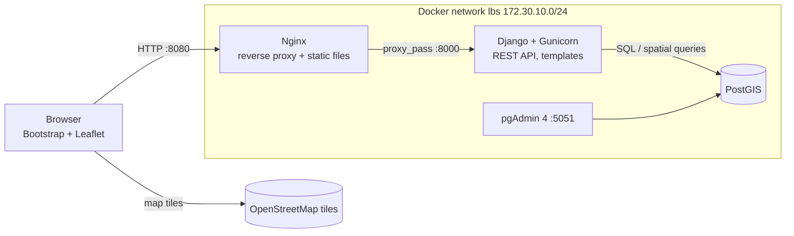
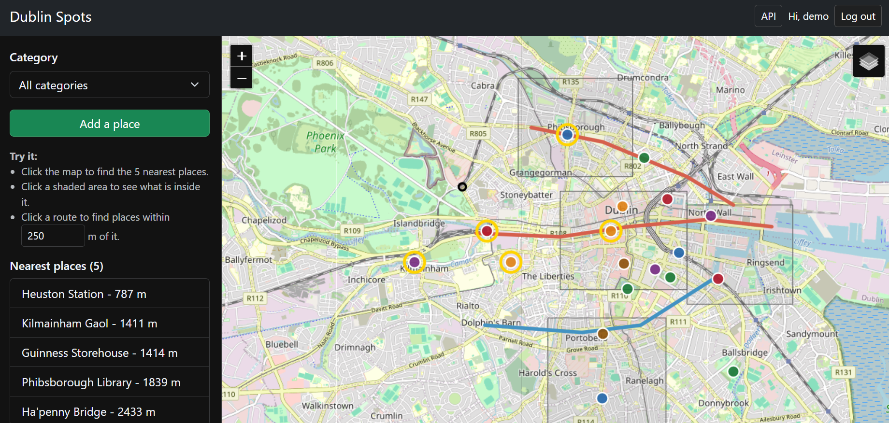
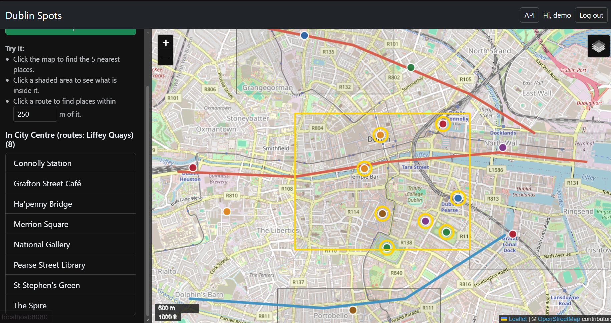
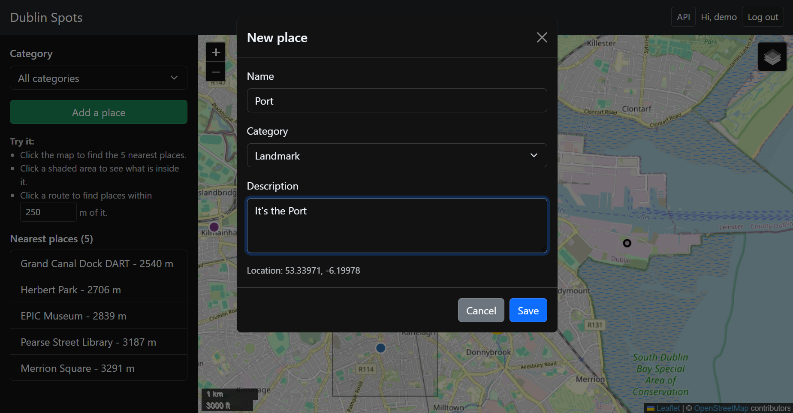
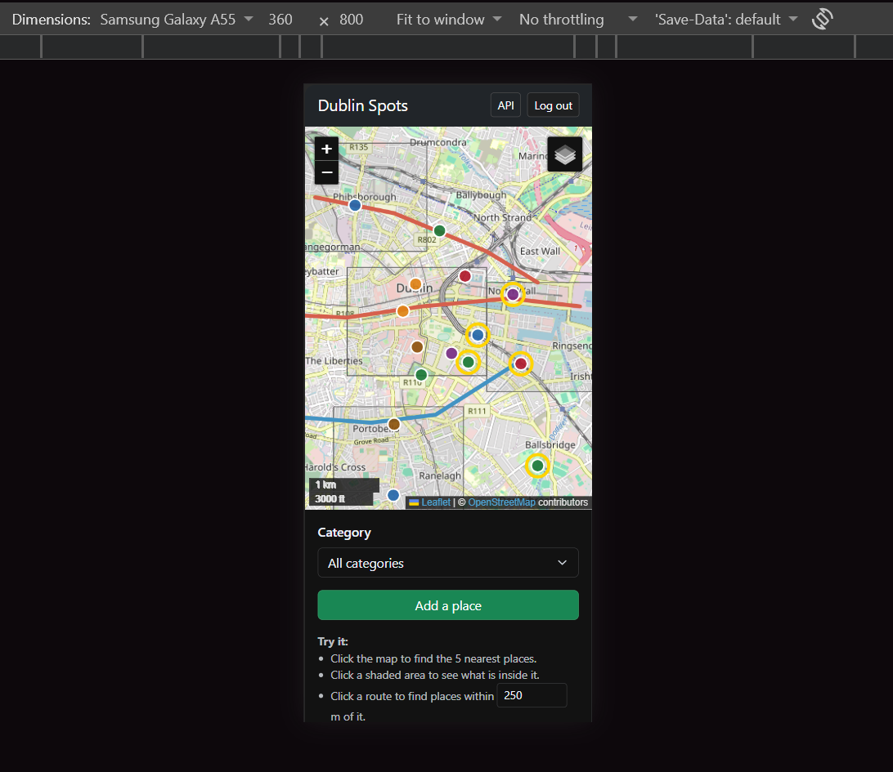

# Dublin Spots – Location-Based Services App

A small LBS web app for exploring places around Dublin. Places (points), walking/cycling routes (lines) and neighbourhoods (polygons) are stored in PostGIS, served by a Django REST API and shown on a Leaflet map.

## Features

- Interactive Leaflet/OpenStreetMap map with zoom, pan, scale bar, layer toggle and popups
- **Nearest places**: click anywhere on the map to list the 5 closest places, with distances in metres
- **What's in this area**: click a neighbourhood to list the places inside it and the routes crossing it
- **Places along a route**: click a route to see the places within N metres of it, with the buffer drawn on the map
- Filter places by category
- Logged-in users can add (click the map), edit and delete places
- Responsive Bootstrap 5 layout: sidebar beside the map on desktop, stacked above it on mobile/tablet
- Fully containerised: Django + Gunicorn, PostGIS, pgAdmin 4 and Nginx reverse proxy on an isolated Docker network

## Technology stack

| Layer | Technology |
|---|---|
| Database | PostgreSQL 16 + PostGIS 3.4 (`postgis/postgis:16-3.4`), pgAdmin 4 |
| Middle tier | Django 5, GeoDjango, Django REST Framework, djangorestframework-gis, Gunicorn |
| Front end | Bootstrap 5.3, Leaflet 1.9.4, OpenStreetMap tiles, plain JavaScript |
| Deployment | Docker Compose, Nginx 1.27 |

## Setup (local Docker deployment)

Requires Docker Desktop.

```bash
cp .env.example .env        # then change the passwords and secret key
docker compose up -d --build
```

| Service | URL |
|---|---|
| App | http://localhost:8080 |
| REST API (browsable) | http://localhost:8080/api/ |
| Django admin | http://localhost:8080/admin/ |
| pgAdmin | http://localhost:5051 (add server: host `db`, port `5432`, user/password from `.env`) |

On start the `web` container automatically runs migrations, collects static files, loads sample Dublin data (only if the tables are empty) and creates the superuser from `.env`.

**Test credentials:** the username and password in `DJANGO_SUPERUSER_USERNAME` / `DJANGO_SUPERUSER_PASSWORD` in `.env` (`demo` by default).

Run the tests:

```bash
docker compose exec web python manage.py test
```

Stop with `docker compose down`. Data is kept in the `db_data` volume, so it survives restarts. Use `docker compose down -v` to wipe it.

## User guide

1. Open http://localhost:8080.
2. Click anywhere on the map: the sidebar lists the 5 nearest places and highlights them. Click a result to fly to it.
3. Click a grey shaded neighbourhood to list the places inside it and the routes crossing it.
4. Click a coloured route (blue = walking, red = cycling) to find places within the distance set in the sidebar (default 250 m).
5. Use the **Category** dropdown to filter places. The nearest query follows the same filter.
6. **Log in** (top right), then use **Add a place** and click the map to drop a new place. Open a place's popup to **Edit** or **Delete** it.

## Architecture



MVC mapping in Django: **Model** = `places/models.py` (GeoDjango models), **View** = `templates/` + `static/app.js`, **Controller** = `places/views.py` (DRF viewsets) and `places/urls.py`.

Only Nginx (8080) and pgAdmin (5051) are published to the host. The database is reachable only inside the Docker network.

## Database schema

All geometries are stored in WGS84 (SRID 4326). GeoDjango adds a **GiST spatial index** to every geometry column.

| Table | Column | Type |
|---|---|---|
| `places_neighbourhood` | `id` | bigint PK |
| | `name` | varchar(100), unique |
| | `boundary` | geometry(Polygon, 4326), GiST index |
| `places_route` | `id` | bigint PK |
| | `name` | varchar(100) |
| | `kind` | varchar(10): `walk` / `cycle` |
| | `path` | geometry(LineString, 4326), GiST index |
| `places_place` | `id` | bigint PK |
| | `name` | varchar(100) |
| | `category` | varchar(20): `cafe`, `park`, `museum`, `library`, `transport`, `landmark` |
| | `description` | text |
| | `location` | geometry(Point, 4326), GiST index |
| | `created_at` | timestamptz |

Migrations are in `places/migrations/`. Sample data is in `places/management/commands/seed.py`.

### Spatial queries

| # | Type | Where | What it does |
|---|---|---|---|
| 1 | Proximity / KNN | `PlaceViewSet.nearest` | `Distance(location, point)` annotation ordered ascending (`ST_DistanceSphere`), returns metres |
| 2 | Containment + intersection | `NeighbourhoodViewSet.contents` | `location__within=boundary` (`ST_Within`) and `path__intersects=boundary` (`ST_Intersects`) |
| 3 | Buffer | `RouteViewSet.nearby` | Route transformed to Irish Transverse Mercator (EPSG:2157), buffered by N metres (`ST_Buffer`), transformed back, then `location__within` the corridor |

## API documentation

Base URL: `http://localhost:8080/api/`. Responses are GeoJSON. Reads are public. Writes need a logged-in session and a CSRF token.

| Method | Endpoint | Description |
|---|---|---|
| GET | `/places/?category=park` | All places, optional category filter |
| POST | `/places/` | Create a place (login required) |
| GET / PUT / PATCH / DELETE | `/places/{id}/` | Read / update / delete a place (writes need login) |
| GET | `/places/nearest/?lat=53.345&lng=-6.26&limit=5` | N nearest places with `distance_m` (limit 1–50) |
| GET | `/neighbourhoods/` , `/neighbourhoods/{id}/` | Neighbourhood polygons |
| GET | `/neighbourhoods/{id}/contents/` | `{places, routes}` inside / crossing the area |
| GET | `/routes/` , `/routes/{id}/` | Routes |
| GET | `/routes/{id}/nearby/?distance=250` | `{corridor, places}` within the buffer (10–2000 m) |

Create example (GeoJSON Feature):

```json
{
  "type": "Feature",
  "geometry": {"type": "Point", "coordinates": [-6.26, 53.34]},
  "properties": {"name": "New café", "category": "cafe", "description": "Nice coffee"}
}
```

### Validation and errors

- Bad or out-of-range query parameters (`lat`, `lng`, `limit`, `distance`) return **400** with a message per field.
- Place names cannot be blank, the category must be one of the allowed values, and the location must be inside County Dublin. Invalid input returns **400**.
- Writes without logging in return **403**. Unknown ids return **404**.

## Security

- Secrets and credentials come from `.env`, which is git-ignored. `.env.example` holds the template only.
- `DEBUG=False` by default, `ALLOWED_HOSTS` is set from the environment, and Gunicorn serves the app instead of the dev server.
- The container runs as a non-root user. The database port is not exposed to the host.
- CSRF protection on all writes, HTTP-only session cookies, `X-Frame-Options: DENY`, `nosniff`, and the Nginx version is hidden.
- User-entered text is HTML-escaped before it is shown in popups (prevents XSS).

## Screenshots

**Desktop: nearest places query**



**Route buffer query**



**Adding a place (logged in)**



**Mobile view**



## Known issues / limitations

- Neighbourhoods and routes are read-only through the API. Edit them in the Django admin.
- HTTP only (no TLS). That is fine for local deployment, but a real deployment would add HTTPS in Nginx and set `SESSION_COOKIE_SECURE` / `CSRF_COOKIE_SECURE`.
- No user sign-up page. Users are created in the Django admin.
